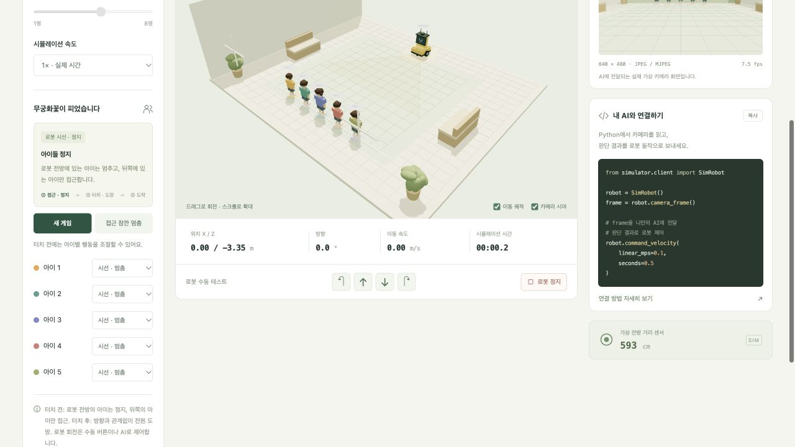

# SerBot AGV 시뮬레이터

SerBot AGV용 AI를 개발할 때 사용하는 로컬 3D 시뮬레이터입니다. 가상 아이들의 움직임과 로봇 시점의 영상을 제공하고, 외부 Python 프로그램에서 로봇을 제어할 수 있습니다.

**술래잡기·얼음땡·무궁화꽃이 피었습니다**를 지원합니다. 아이마다 속도·반응 시간·체력·구조 성향이 다르며 게임별로 도망·잡힘·구조·정지·탈락을 처리합니다. 로봇 자동 제어는 정답 위치를 사용하는 규칙 기반 시연입니다. 영상 인식 AI와 학습된 모델은 포함하지 않으며, 선택적으로 실행하는 PPO 학습 예제를 제공합니다.



## 각자 컴퓨터에서 실행하기

1. **준비:** [Python 3.10 이상](https://www.python.org/downloads/)과 WebGL을 지원하는 브라우저를 준비합니다. 기본 실행에는 추가 패키지 설치가 필요하지 않습니다.
2. **다운로드:** [GitHub 저장소](https://github.com/ma1ing1ing/serbot-agv-simulator)에서 **Code → Download ZIP**을 누르고 압축을 풉니다. 비공개 저장소이면 초대받은 계정으로 로그인하고 초대를 수락해야 합니다.
3. **실행:** `README.md`와 `simulator` 폴더가 함께 있는 프로젝트 폴더에서 아래 방법으로 명령 창을 열고, 자신의 운영체제에 맞는 명령을 입력합니다.

| 운영체제 | 프로젝트 폴더에서 명령 창 열기 | 서버 실행 명령 |
|---|---|---|
| Windows | 파일 탐색기의 주소 표시줄에 `powershell` 입력 후 Enter | `py -m simulator.server` |
| macOS | 터미널에 `cd ` 입력 → 프로젝트 폴더를 끌어다 놓기 → Enter | `python3 -m simulator.server` |

명령 창을 켜 둔 채로 브라우저에서 **<http://127.0.0.1:8767>**을 열고 **놀이 선택 → 로봇 자동 제어 → 게임 시작**을 선택합니다. 각자 컴퓨터에서 독립된 게임이 실행됩니다. 종료는 명령 창에서 **Ctrl+C**, 다음 실행은 같은 폴더에서 위 명령을 다시 입력하면 됩니다.

Windows에서 `py`를 찾지 못하면 `python`으로 바꿔 실행하세요. HTML 파일을 더블클릭하는 대신 위 주소로 접속하고, 가상 카메라를 사용할 때는 브라우저 탭을 활성 상태로 유지합니다. 포트 오류 등은 [실행 문제 해결](docs/QUICKSTART.md#문제-해결)을 참고하세요.

## 게임 사용법

| 게임 | 아이들의 행동과 종료 |
|---|---|
| 술래잡기 | 로봇을 피해 도망. 잡히면 정지. 전원 잡힘 또는 시간 초과로 종료 |
| 얼음땡 | 잡히면 얼음. 친구가 가까이에서 0.6초 머무르면 해제. 전원 얼음 또는 시간 초과로 종료 |
| 무궁화꽃이 피었습니다 | 뒤돌면 접근, 바라보면 반응 시간 이후 정지. 늦게 멈추면 탈락. 터치 후 도망·추격을 거쳐 종료 |

**경찰과 도둑**은 목록에 구현 예정으로만 표시하며 해당 담당자가 연결합니다. **환경은 장애물 없는 공간 하나로 통일하며 배치 선택 메뉴는 없습니다.** 게임 시작 전에 **아이 수·난수 시드·제한 시간**을 설정합니다. 같은 시드·설정이면 같은 가상 행동을 재현하고 시드를 바꾸면 배치와 성향이 바뀝니다. 잡힘 기준은 기본 중심 거리 0.74m입니다. 수동 주행이나 Python 명령은 자동 제어를 해제합니다. 게임 중 **놀이 잠깐 멈춤**, **게임 종료**를 사용할 수 있습니다. [상세 규칙](docs/SIMULATION.md)을 참고하세요.

## 선택: 기록 저장과 데이터 생성

**기록 저장은 기본으로 꺼져 있습니다.** 화면에서 **플레이 기록 저장**을 켜고 시작하면 `artifacts/episodes/`에 한 판당 설정(`config.json`), 0.1초마다 상태·관측·행동(`steps.jsonl`), 사건(`events.jsonl`), 결과(`summary.json`)를 저장합니다. 게임 종료·초기화·새 게임·정상 서버 종료 시 마감합니다.

여러 판의 데이터 생성은 아래 명령을 **직접 실행했을 때만** 시작합니다. 서버·브라우저는 필요하지 않으며 Windows에서는 `python3` 대신 `py`를 사용합니다.

```bash
# 게임별 100판, 총 300판. 판마다 최대 120 가상 초
python3 -m simulator.batch --episodes 100 --time-limit 120
```

결과는 `artifacts/datasets/날짜-식별자/`에 학습/검증/평가용 80/10/10판씩 저장합니다. 먼저 `--episodes 1 --time-limit 10`으로 확인할 수 있습니다. 특정 게임은 `--games freeze_tag`, 인원은 `--count 8`, 시작 시드는 `--seed 1000`으로 지정합니다. **데이터 생성 자체가 AI 학습을 수행하지는 않습니다.** [저장 형식·자동 실행 상세](docs/EPISODES.md)를 참고하세요.

## 아이들의 움직임 근거와 데이터셋

아이들의 움직임은 **데이터를 참고한 관절 애니메이션**과 **직접 정의한 게임별 이동·반응 규칙**으로 구성합니다. 실제 어린이와 로봇의 상호작용을 학습한 모델은 포함하지 않습니다. 기본 게임은 데이터를 받지 않아도 실행되며, 아래 데이터셋의 원본·변환 파일은 GitHub에 포함되지 않으므로 각자 내려받아 설정합니다.

| 근거·출처 | 사용하는 정보와 적용 범위 | 준비·상세 |
|---|---|---|
| [ChildACT v1](https://zenodo.org/records/14603227), Sandygulova 외, 2025. DOI: `10.5281/zenodo.14603227` | 배포 ZIP의 관절 배열에서 걷기·조깅·달리기 각도 변화를 추출해 팔다리 애니메이션에 적용. 바닥 이동 경로나 로봇 대응 전략은 제공하지 않음 | [다운로드·변환](docs/CHILDACT.md) |
| [Playground A 위치 CSV · GraphSD 배포본](https://github.com/centeio/GraphSD/blob/c8981a2cfbe5b522275dd29dde58f75afbeec5fe/graphsd/datasets/data/playground_a_position_data_anonymized.csv) | `id,time,x,y`로 구성된 16명·64,604행의 위치 기록. 별도 기록 재생 모드에 사용하며 관절·로봇 대응 행동은 포함하지 않음 | [다운로드·변환](docs/PLAYGROUND_A.md) |
| 프로젝트의 [게임 행동 규칙](simulator/games.py) | 로봇의 거리·접근 속도·방향에 따른 도망, 주변 아이·경계 회피, 체력·반응 지연 및 게임별 정지·구출·잡힘 처리 | [규칙과 설정값](docs/SIMULATION.md) |

**관절 애니메이션의 처리와 한계:** [변환기](tools/build_childact_motion.py)는 단일 대상의 `(1,25,3)` 배열을 2차원 x·y·신뢰도로 해석하고, 일부 누락값 보간·평활화를 거쳐 양쪽 어깨·팔꿈치·고관절·무릎의 각도와 몸통 기울기를 추출합니다. 관절 순서는 [OpenPose BODY_25 문서](https://github.com/CMU-Perceptual-Computing-Lab/openpose/blob/master/doc/02_output.md)를 참고한 추정이며, ChildACT 제공자가 확인한 메타데이터는 아닙니다. 선택 구간을 64개 표본의 반복 동작으로 바꾸고 캐릭터 체형에 맞춰 보정하므로 완전한 3차원 모션 캡처가 아닙니다. 원본 프레임 속도는 확인되지 않았으며 걷기 1.05초·조깅 0.86초·달리기 0.72초의 반복 주기는 시뮬레이션 설정값입니다.

화면에 **ChildACT 동작 연결됨**이 표시될 때 데이터 기반 애니메이션이 적용됩니다. **기본 동작 사용 중**이면 수학 함수로 생성한 팔다리 애니메이션을 사용하며, 새로 내려받은 저장소는 별도 데이터 준비 전까지 이 기본 동작으로 실행됩니다. ChildACT ZIP을 받은 뒤 아래 명령으로 변환하고 서버를 실행합니다. Windows에서는 `python3`를 `py`로 바꾸세요.

```bash
python3 tools/build_childact_motion.py /path/to/ChildACT.zip
python3 -m simulator.server
```

**게임 이동 규칙의 근거와 한계:** 게임 모드의 바닥 좌표는 데이터셋의 경로를 복사하지 않고 현재 로봇 상태와 게임 규칙으로 계산합니다. 아이별 반응 지연 0.08~0.65초, 기본 잡힘 중심 거리 0.74m, 속도·체력·구출 성향은 행동 차이와 제어 실험을 위해 정한 값이며 실제 어린이 실험에서 추정한 값이 아닙니다. 기록·일괄 생성 기능에서 만드는 게임 데이터도 이 규칙에 따른 합성 데이터입니다. 자동 테스트는 규칙·판정·재현성을 검사하며 실제 어린이 행동의 정확성을 검증하지 않습니다.

Playground A는 **놀이 선택 → Playground A · 위치 기록 재생 → 기록 재생**으로 실행합니다. **위에서** 보기와 **이동 궤적**을 켜면 경로를 볼 수 있습니다. 공통 시간축의 좌표를 보간하고 가상 공간에 맞춰 균일 축척으로 변환하며, 원본 좌표·시간의 단위는 확인되지 않아 실측 미터·초로 확정하지 않습니다. 기록 재생 중인 아이들은 로봇의 움직임에 반응하지 않고, 화면의 팔다리 동작도 해당 위치 데이터에 포함된 관절 기록이 아닙니다. 원본 출처·변환 가정·누락 구간 처리와 데이터 제공 조건 확인 사항은 각 상세 문서를 참고하세요.

## 팀원의 로봇 제어 모델 연결

**게임별 기본 로봇 제어기가 준비되어 있습니다.** 화면의 **로봇 자동 제어** 또는 Python의 `--controller rule`은 술래잡기에서 미포획 아이 추격, 얼음땡에서 얼지 않은 아이 추격, 무궁화에서 바라보기·뒤돌기 반복 후 터치 시 추격을 수행합니다. 각 제어기는 [controllers.py](simulator/controllers.py)의 `TagController`·`FreezeTagController`·`RedLightController`로 분리되어 있으며 [실행·고정 설정 안내](docs/TRAINING.md#게임별-기본-로봇-제어기)를 참고하세요. 반복 실행으로 제어기 자체가 학습되지는 않으며, 아이들 AI 학습 기능은 아직 포함하지 않습니다.

**“아이들이 로봇과 상호작용하지 않는 것 같은데 어떻게 사용하나요?”** 게임 모드의 아이들은 현재 로봇 상태를 입력받아 규칙에 따라 반응합니다. 술래잡기·얼음땡에서는 로봇의 거리·접근 속도·방향에 따라 도망 방향과 속도가 달라지고, 무궁화꽃이 피었습니다에서는 로봇이 바라보는 방향에 따라 접근하거나 멈춥니다. 로봇이 멀리 있으면 배회하는 모습이 보일 수 있고, 잡히거나 얼음·탈락 상태가 된 아이는 멈춥니다. 반면 **Playground A는 고정된 위치 기록을 재생하므로 로봇에 반응하지 않습니다.** ChildACT는 팔다리 표현에 사용하는 자료이고, 도망 판단은 별도의 게임 규칙이 담당합니다.

팀원은 **자신이 맡은 게임에서 로봇 제어기를 교체**해 사용하면 됩니다. 로봇 모델의 출력으로 실제 로봇 위치·속도·방향이 바뀌면 아이들의 반응도 다시 계산되므로, 아이들 코드를 함께 학습시키거나 고칠 필요 없이 제어기를 연결할 수 있습니다. 화면에서는 **술래잡기 또는 얼음땡 → 게임 시작 → 수동 주행으로 아이에게 접근**해 반응을 확인하고, 모델 연결 시에는 자동 제어를 끈 뒤 Python으로 명령을 보냅니다. 게임 일시정지·종료 상태에서는 반응하지 않으며, 브라우저 없는 `PlayEnv`는 `step()`을 호출할 때만 진행합니다. 이 환경은 규칙 기반 가상 아이를 상대로 제어 로직·게임 성과를 비교하는 용도이며 실제 어린이의 반응을 예측하거나 검증하는 모델은 아닙니다.

각자 서버를 실행해 화면을 보거나, 아래처럼 서버·브라우저 없이 제어기를 한 판 실행할 수 있습니다. Windows에서는 `python3` 대신 `py`를 사용합니다.

```bash
python3 -m simulator.examples.controller_client --game tag --controller rule
python3 -m simulator.examples.controller_client --game freeze_tag --controller my_policy:create_controller
```

팀원은 `reset(seed)`·`predict(observation)`를 가진 제어기를 만들고 전진·회전 속도를 반환합니다. `PlayEnv.reset()/step()`은 행동한 만큼만 시간을 진행하므로 모델 추론 속도에 따라 게임 시간이 달라지지 않습니다. [제어기·학습 연결](docs/TRAINING.md)과 [팀 작업 규칙](docs/TEAMWORK.md)을 참고하세요. 로봇 주행은 같은 가속·감속·충돌 처리를 사용하고, 관측은 정답 좌표 기반 `oracle`과 외부 검출 기반 `sensor`를 구분합니다. 같은 조건의 제어기 비교는 `python3 -m simulator.evaluate --game tag --controllers rule idle`로 실행합니다.

처음 모델을 연결한다면 [PPO 학습·저장·불러오기 예제](docs/TRAINING.md#ppo로-학습저장불러오기)를 따라 **패키지 설치 → 게임·보상 설정 → 학습·모델 저장 → 저장 모델 연결 → 기본 제어기와 비교**를 진행하세요. 학습과 반복 평가는 서버·브라우저 없이 실행하며 예제 모델의 성능은 별도로 평가합니다.

## 내 Python 영상 AI와 연결

서버와 브라우저를 켜 둔 후 **다른 터미널에서 이 저장소를 작업 경로로** 프로그램을 실행합니다.

```python
from simulator.client import SimRobot

robot = SimRobot()
robot.start_game('freeze_tag', auto_chase=False)  # 외부 AI가 로봇을 제어할 때
jpeg = robot.camera_frame()  # bytes: 로봇 시점 영상

# jpeg를 자신의 AI에 입력하고, 판단 결과에 따라 명령을 보냅니다.
robot.command_velocity(linear_mps=0.1, angular_rps=0.0, seconds=0.5)
robot.stop()
```

카메라는 브라우저가 렌더링합니다. 탭이 닫혔거나 프레임이 오래되면 영상 API가 `503`을 반환합니다. [AI 연결 문서](docs/AI_INTEGRATION.md)에는 영상 준비 대기, OpenCV 입력, 비동기 명령, 기존 SerBot 스타일의 제어 예제가 있습니다.

## 문서

| 문서 | 내용 |
|---|---|
| [시작하기](docs/QUICKSTART.md) | 실행·화면 사용·포트 변경·자주 생기는 문제 |
| [로봇 제어·학습](docs/TRAINING.md) | 공통 관측·행동, 단계 실행, 제어기 교체 |
| [팀 작업](docs/TEAMWORK.md) | 역할·코드 수정 범위·버전·게임 확장 |
| [AI 연결](docs/AI_INTEGRATION.md) | Python 클라이언트, OpenCV, 모델 입출력 연결 |
| [API](docs/API.md) | HTTP 경로·요청 예제·응답·단위·오류 |
| [기록과 데이터 생성](docs/EPISODES.md) | 선택적 저장·자동 실행·시드·파일 형식 |
| [게임 규칙과 모델](docs/SIMULATION.md) | 방향·터치·도망 판정, 좌표계, 가상 환경의 한계 |
| [구조](docs/ARCHITECTURE.md) | 서버·엔진·브라우저·AI 사이의 데이터 흐름 |
| [개발과 테스트](docs/DEVELOPMENT.md) | 코드 위치, 테스트, GitHub Actions, 수정 시 확인할 점 |
| [소리·움직임 연구](docs/research/PET_ROBOT_SOUND_MOTION.md) | 사람과 로봇 사이의 장벽을 낮추는 설계 선택, 사용자 연구, 로보또 적용 가설 |
| [외부 라이브러리](THIRD_PARTY_NOTICES.md) | Three.js 버전과 라이선스 |

## 검증

```bash
python3 -m unittest discover -s simulator/tests -v
node --check simulator/static/app.js
node --test simulator/tests/motion.test.mjs
```

자동 테스트가 세 게임·제어기 교체·단계 실행·재현성·관측 분리·선택적 기록·이동·충돌·카메라 API를 검사합니다. Gymnasium 검사는 선택 패키지 설치 시 실행됩니다. JavaScript 검사에는 Node.js가 필요하며, **시뮬레이터 실행 자체에는 Node.js가 필요하지 않습니다.**

## 실제 로봇과의 차이

로봇과 아이들은 간략한 3D 모델이고, 주행·센서는 근사치입니다. CAD 수준의 치수·동역학, 실제 카메라 노이즈, 실제 사람에 대한 AI 인식 성능을 재현하지 않습니다. 가상 환경에서 통과한 결과는 실제 AGV에서도 별도로 확인해야 합니다.

기본 서버는 `127.0.0.1`에서만 실행됩니다. 이 저장소에는 실제 로봇의 SSH 연결·비밀번호·배포 도구가 들어 있지 않습니다.
