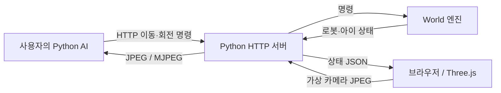

# 구조

[README로 돌아가기](../README.md) · [개발과 테스트](DEVELOPMENT.md)

## 데이터 흐름



**서버가 세계 상태를 소유하고, 브라우저가 영상을 렌더링합니다.** 따라서 브라우저를 닫아도 세계 시간은 서버에서 계속 흐를 수 있지만 카메라 영상은 생성되지 않습니다.

## 파일 역할

```text
serbot-agv-simulator/
├── README.md                  # 실행과 주요 문서 안내
├── pyproject.toml             # 선택적 Python 패키지 설치
├── docs/
│   ├── QUICKSTART.md          # 사용 시작과 문제 해결
│   ├── AI_INTEGRATION.md      # Python AI 입출력 연결
│   ├── API.md                 # HTTP 계약과 응답
│   ├── SIMULATION.md          # 게임 판정과 근사 모델
│   ├── ARCHITECTURE.md        # 이 문서
│   ├── DEVELOPMENT.md         # 수정·검증 방법
│   └── assets/preview.jpg     # 가상 화면 예시
└── simulator/
    ├── engine.py              # 로봇·아이·충돌·게임 상태
    ├── tag_game.py            # 합성 도망 경로·자동 추격·잡힘 판정
    ├── server.py              # 정적 화면, HTTP API, 세계 tick
    ├── client.py              # 외부 Python용 SimRobot
    ├── examples/camera_client.py
    ├── tests/                 # 자동 테스트와 선택적 실영상 연결 검사
    └── static/
        ├── index.html         # 한국어 UI
        ├── style.css          # 레이아웃·스타일
        ├── app.js             # 3D 장면·애니메이션·카메라 발행
        ├── motion.js          # 관절 동작 보간·기본 동작 대체
        ├── motions/           # Git에서 제외한 로컬 ChildACT 변환 데이터
        └── vendor/            # 고정 버전 Three.js / OrbitControls
```

## 세계 엔진

`World`는 로봇 위치·속도, 아이들의 행동, 게임 상태, 거리 센서, 로그와 궤적을 관리합니다. `tick()`에서 시간과 동작을 진행합니다. 공유 상태는 `RLock`으로 보호하고 `snapshot()`은 복사본을 반환합니다.

서버의 별도 스레드가 약 20ms 간격으로 tick을 호출합니다. 테스트에서는 고정 시간 간격을 직접 주므로 브라우저 없이 게임 규칙을 검사할 수 있습니다.

주행 명령은 ID를 갖고 한 번에 하나만 실행됩니다. 새 명령이 이전 명령을 대체합니다. 결과 조회는 HTTP 명령 수명과 Python의 대기 처리를 연결합니다.

## 브라우저

`app.js`는 대략 65ms 이상 간격으로 상태를 요청하고 Three.js 장면에 반영합니다. 가상 로봇의 pose로 별도 카메라를 배치하고 640×480 JPEG를 약 125ms 이상 간격으로 서버에 보냅니다. 실제 속도는 브라우저와 하드웨어에 따라 달라집니다.

관찰자 카메라와 AI용 카메라는 분리됩니다. 관찰자용 이름표·시야 표시·이동 궤적은 별도 레이어에 놓아 AI용 영상에 포함하지 않습니다.

`tools/build_childact_motion.py`가 사용자의 ZIP에서 관절 각도 변화를 추출합니다. `motion.js`가 이를 캐릭터의 관절에 근사 적용합니다. 이 변환 데이터에는 바닥의 m 단위 궤적이 없습니다. 바닥 위치는 `tag_game.py`에서 생성하고, 관절 재생 시간은 실제 시뮬 이동 속도에 맞춰 진행합니다. 자동 추격은 정답 위치를 사용하며 외부 AI의 주행 명령은 자동 추격을 해제합니다.

## 프레임 수명

초기화나 게임 재시작마다 세계의 `epoch`가 달라집니다. 브라우저가 이전 epoch의 프레임을 늦게 보내면 서버는 409로 거부합니다. 영상이 현재 epoch에 속하고 2.5초 이내에 발행되어야 카메라 `ready=true`가 됩니다.

세계 시간은 가상 시간이고 프레임 신선도는 실제 단조 시간으로 측정합니다. 일시정지 중에도 새로 렌더링된 같은 장면을 정상 프레임으로 제공할 수 있는 이유입니다.

## 연결 경계

`SimRobot`은 HTTP 클라이언트입니다. 하드웨어용 `serbot_control`, SSH, ROS, CAN을 import하거나 실행하지 않습니다. 실제 로봇의 제어 라이브러리와 유사한 편의 메서드는 있지만 내부 구현은 별개입니다.

서버는 로컬 전용이며 클라우드 배포용 인증·사용자 분리·세션 격리를 제공하지 않습니다. 렌더러 토큰은 프레임 발행 구분용 임시 값입니다. 여러 사용자나 인터넷에 공개하는 서버로 사용하려면 별도 설계가 필요합니다.
