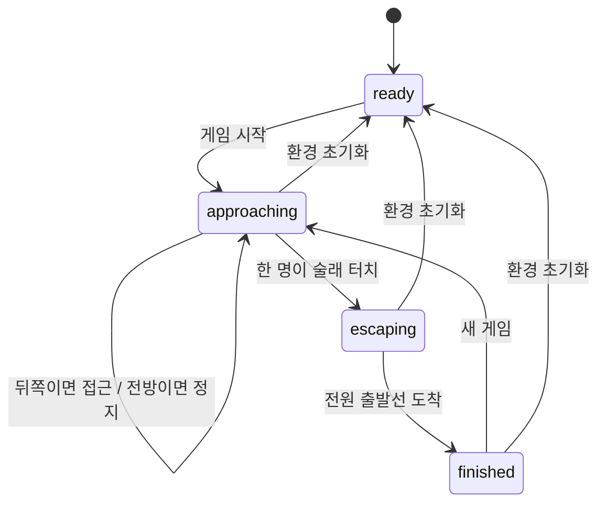

# 게임 규칙과 모델

[README로 돌아가기](../README.md)

## 기본 놀이: 술래잡기

`tag`가 기본 모드입니다. `ready → chasing → finished` 순서로 진행합니다. 로봇이 술래이고 아이들은 로봇과의 거리, 다른 아이와의 간격, 벽과 벤치의 위치에 따라 방향과 속도를 바꿉니다. 가까우면 달리며, 멀면 걷고, 달리면 줄어드는 가상 체력에 따라 잠깐 속도를 낮춥니다. 실제 어린이에게 측정한 행동 모델은 아닙니다.

로봇과 아이의 중심 거리가 0.74m 이하면 그 아이만 잡힙니다. 잡힌 아이는 멈추며 다른 아이는 계속 도망갑니다. 전원이 잡히면 `finished`입니다. 자동 추격은 정답 좌표를 보는 규칙 기반 시연으로, 장애물 회피나 추적 전략의 최적성을 보장하지 않습니다.

자동 추격은 체크박스로 켜거나 끌 수 있습니다. 수동 버튼·Python 주행 명령·정지 명령은 자동 추격을 해제하며, 명령이 끝나도 자동으로 다시 켜지지 않습니다. 외부 AI 평가 시에는 `robot.start_game(auto_chase=False)`로 시작합니다. `hold_children()`는 술래잡기 참가자의 이동을 멈추지만 세계 시간은 진행합니다. 세계 일시정지는 시간까지 멈춥니다.

캐릭터 관절은 [ChildACT 변환 모션](CHILDACT.md)을 읽을 수 있습니다. 관절 애니메이션과 바닥의 m 단위 이동 경로는 별도로 계산하며, 실제 어린이의 이동 궤적을 그대로 재생하는 기능은 아닙니다.

## 기존 놀이: 무궁화꽃이 피었습니다

화면에서 선택하거나 `robot.start_game('red_light')`로 시작합니다.

이 모드에서 로봇이 언제 구호를 외치고, 언제 뒤돌고, 누가 움직였는지 판단하는지는 외부 AI의 역할입니다. 아래 시선·터치·출발선 규칙은 이 모드에만 적용됩니다.

## 방향 판정

로봇의 위치·회전각과 각 아이의 상대 위치를 사용합니다. **로봇 전방 180°에 있으면 정지, 뒤쪽 180°에 있을 때만 접근**합니다. 정확히 옆에 있을 때도 멈춥니다. 회전 중에는 어떤 아이는 전방이고 다른 아이는 뒤쪽일 수 있습니다.

이 판정은 카메라 AI로 추론한 결과가 아닙니다. 실제 렌더링 카메라는 수평/수직 화각의 영향을 받지만, 게임의 방향 판정은 전방/후방 반공간으로 단순화되어 있습니다. 단순히 카메라 프레임 밖이라고 접근할 수 있는 것은 아닙니다.

게임 시작 시 로봇은 +Z 방향으로 아이들을 바라보므로 아이들은 정지합니다. 수동 제어나 AI가 로봇을 돌리면 접근을 시작합니다. 바라볼 때는 보행과 제자리 팔 움직임도 멈춥니다. 수동 접근 멈춤(`held`)을 켜면 뒤쪽에서도 멈춥니다.

## 터치와 도망

- 로봇 중심과 아이 중심의 바닥 거리 **0.74m 이내**를 가상 터치로 판정합니다. 몸체와 팔 뻗기를 근사한 값입니다.
- 첫 터치가 발생하면 전원 `escaping` 상태로 바뀝니다. 누가 터치했는지와 가상 시각을 한 번 기록합니다.
- 멈춰 있던 아이도 도망갑니다. 이후에는 로봇 방향이나 수동 접근 멈춤보다 도망 규칙이 우선합니다.
- 각 아이는 자신의 출발 위치 `(home_x, z=3.2)`로 달립니다. 도착하면 그 자리에 멈춥니다.
- 전원 도착 시 `finished`가 됩니다. 자동으로 다시 접근하거나 왕복 순찰하지 않습니다.

아이들은 단순한 목적지 이동과 충돌 회피를 사용합니다. 로봇이 탈출 경로를 막았을 때 복잡한 우회 경로를 계획하는 기능은 없습니다. 보행 의도(`moving`)가 있어도 다른 물체에 막혀 좌표가 움직이지 않을 수 있습니다.

## 좌표와 주행

| 항목 | 기준 |
|---|---|
| 바닥 / 높이 | X·Z / Y |
| 거리 | m |
| 초기 로봇 위치 | X=0, Z=-3.35 |
| 방향 0 | +Z |
| 양의 회전 | +Z에서 -X로 도는 왼쪽 회전 |
| 각도 | rad, 화면 방향 표시만 ° |
| 시간 | 서버가 진행하는 가상 초 |

로봇은 바닥 평면의 선속도·각속도로 움직입니다. 이동은 작은 구간으로 나눠 충돌을 확인하며, 벽·벤치·아이와의 단순 몸체 충돌을 막습니다. 기본 주행 가드는 전진/후진 방향의 가상 거리 20cm입니다. 이는 실제 AGV의 제동 거리나 안전 센서를 검증하는 기능이 아닙니다.

기존 SerBot 스타일 속도는 기본적으로 1당 `0.025m/s`, 회전 1당 `0.24rad/s`로 변환됩니다. 실측 보정값이 아니므로 정확한 단위 실험에는 `command_velocity()`를 사용합니다.

## 일시정지와 배속

세계 일시정지는 로봇·아이·가상 시간을 멈춥니다. 외부 AI의 추론과 `time.sleep()`은 계속됩니다. 카메라는 정지한 세계를 새 프레임으로 계속 렌더링할 수 있습니다.

배속은 세계 시간과 동작 지속시간에 적용됩니다. 예를 들어 2×에서는 1 가상 초가 대략 0.5 실제 초입니다. 컴퓨터가 느리면 정확한 실시간 비율이 유지되지는 않습니다. 서버의 tick은 실제 경과 시간을 최대 0.05초로 제한하므로, 긴 정지 구간을 한 번에 따라잡지 않습니다.

## 재현하지 않는 것

- 제조사 CAD와 정확한 치수·질량·관성
- 실제 모터 응답, 바퀴 미끄러짐, 제동 성능, 충돌 역학
- 렌즈 왜곡, 카메라 노이즈, 실제 아이의 외형과 행동 다양성
- 실제 거리 센서의 반사·잡음 특성
- 실제 네트워크 지연·로봇 통신 단절·하드웨어 고장

로봇은 [한백전자 SerBot AGV](https://hanback.com/ko/archives/11695)의 구조를 참고한 간략 모델입니다. 제조사 공식 시뮬레이터나 디지털 트윈은 아닙니다. 아이들도 프로젝트 안에서 만든 단순 3D 인체 모델입니다. 실제 영상으로 학습한 인식 모델의 성능과 실제 로봇 주행은 별도로 검증해야 합니다.
